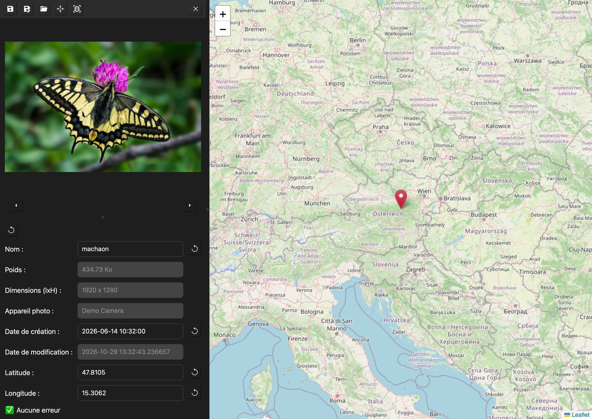

# Exif tools

Version : 2.0.6

Application pour visualiser et modifier les exif d'une photo.

- Ouvrir la photo et la visualiser
- Visualiser ses métadonnées (nom, format, poids, dimensions, date de prise de vue/modification, coordonnées gps)
- Modifier les métadonnées : Date de création et coordonnées géographiques
- Visualiser les coordonnées sur une carte (uniquement en ligne)
- Modifier les coordonnées via la carte

## Aperçu

<p align="center">
  
</p>

<sub>Métadonnées de démonstration. Photo : Uoaei1, [CC BY-SA 4.0](https://commons.wikimedia.org/wiki/File:Papilio_machaon_Mitterbach_01.jpg).</sub>

Pour lancer l'application, lancer dans un terminal :

```bash
pip install -r requirements.txt       # édition full (avec reconnaissance d'espèce par IA)
pip install -r requirements-lite.txt  # édition lite (sans IA, légère)
python3 main.py
```

L'IA est détectée au lancement : sans `torch`/`birder`, la reconnaissance d'espèce est masquée.

Pour incrémenter de version, modifier le fichier `version.txt` et lancer

```shell
python3 bump_version.py
```

## Build l'application pour la déployer

### Faire l'exécutable linux

Dans une machine linux (ou VM)

```bash
pip install pyinstaller
pyinstaller --noconfirm --clean ExifTools.spec                          # full
EXIFTOOLS_EDITION=lite pyinstaller --noconfirm --clean ExifTools.spec   # lite
```

### Faire l'application linux

Armature 64

```bash
chmod +x ./install-arm64.sh
./install-arm64.sh
```

Autre

```bash
chmod +x ./install-all.sh
./install-all.sh
```

Désinstaller

```bash
chmod +x ./uninstall.sh
./uninstall.sh
```
